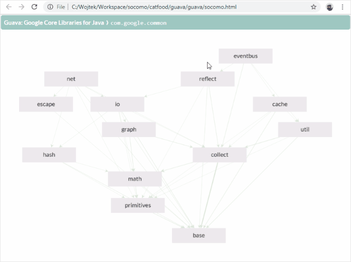
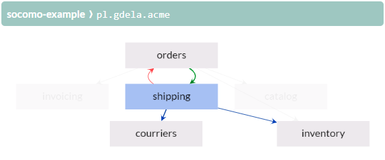

# Socomo - 关心你的 Java 代码组成


Socomo 是一个简单的工具，用于可视化你的源代码组成，并跟踪开发过程中组成的变化。你可以使用这个工具来：

- 通过显示组件依赖图来解释模块的内部设计。
- 通过查看添加的新依赖来确保项目的架构不会被破坏。
- 在博客或 Twitter 上炫耀你的代码结构有多棒，并用图表证明它。

查看 Socomo 如何表示 Guava 项目结构的示例（[完整体验][socomo of guava]）：

<p align="center">
  <a href="https://gdela.pl/socomo-of-guava/socomo.html">
  
  </a>
</p>

[socomo of guava]: https://gdela.pl/socomo-of-guava/socomo.html


## 快速开始

现在就在你的代码上试试！对于用 Maven 构建的项目，执行以下命令：

```bash
mvn pl.gdela:socomo-maven:display
```

或者，对于 jar 文件，下载[最新发布]并执行：

```bash
java -jar socomo-standalone.jar -d path/to/your.jar
```

上述任一命令都会生成 `socomo.html` 文件并在浏览器中打开。你将看到代码结构的交互式可视化。

要跟踪组成的变化，将 `socomo.html` 文件提交到你的源代码仓库，并添加[socomo maven 插件](#socomo-maven-plugin)到你的项目。每当组成发生变化时，插件会更新这个人类可读的文件，这样你就可以在最方便的地方——源代码仓库中拥有变化历史。


## 如何阅读图表

图表显示了代码在特定_level_的组成，通常是项目的顶层包。这个级别下的每个子包都是一个_组件_，在图表中表示为节点。组件在图表上排列成层：一个组件使用位于其下方的其他组件，并被位于其上方的组件使用。

<p align="center">
  
</p>

从字节码分析的实际_依赖_表示为边。边越宽，组件间的依赖越强。点击边以显示依赖详情，即查看一个组件中的哪些类和成员使用了另一个组件中的哪些类和成员。

当你悬停在组件上时，蓝色边显示指向被选中组件使用的组件的外向依赖，棕色边显示来自使用选中组件的组件的内向依赖。红色边是向上指向的依赖，违反了层级，因此是两个或多个组件间循环依赖的原因。

图表是交互式的，以便你提炼所需信息：

- <kbd>点击</kbd>依赖以显示其详情
- <kbd>Ctrl</kbd>+<kbd>点击</kbd> 几个组件以强调它们之间的依赖
- <kbd>Ctrl</kbd>+<kbd>拖拽</kbd> 以选择多个组件
- <kbd>拖拽</kbd> 组件或选中的组件
- <kbd>右键点击</kbd> 组件以隐藏它及其依赖
- <kbd>右键点击</kbd> 背景以撤销组件隐藏
- <kbd>U</kbd> 以撤销隐藏所有组件
- <kbd>R</kbd> 以自动重新排列图表
- <kbd>鼠标滚轮</kbd> 以缩放图表
- <kbd>拖拽</kbd> 背景以平移图表
- <kbd>S</kbd> 以将图表保存为 png 文件


## 组成最佳实践

Socomo 是一个有主见的工具，要求你以正确的方式构建代码以发挥最大作用：

1. 让你的顶层组件谈论业务。它们[不应该告诉你使用哪些框架][screaming architecture]。技术细节对开发者更熟悉，因此[不如业务领域重要][trivial grouping]。

2. 保持你的依赖无环。如果两个组件相互依赖，你无法一次理解和处理它们，它们实际上[形成一个更大的组件][cyclic dependencies]。

3. 让你的组件大小平衡。在数十个较小组件中有一个巨大的组件会违背划分代码的目的。

这些原则将帮助你避免项目成为[大泥球]。

[screaming architecture]: https://blog.cleancoder.com/uncle-bob/2011/09/30/Screaming-Architecture.html
[trivial grouping]: https://devcards.io/trivial-grouping-of-classes
[cyclic dependencies]: https://blog.lattix.com/why-cyclic-dependencies-are-a-problem
[big ball of mud]: http://www.mamuz.de/article/from-big-ball-of-mud-to-emergent-design/0Pw682Kxk


## Socomo Maven 插件

在你的 `pom.xml` 文件的 `<build><plugins>` 部分添加以下片段。对于多模块项目，你可以只添加到父 pom 中，以便所有模块继承。

```xml
<plugin>
  <groupId>pl.gdela</groupId>
  <artifactId>socomo-maven</artifactId>
  <executions>
    <execution>
      <goals>
        <goal>analyze</goal>
      </goals>
      <configuration>
        <level>com.example.myproject</level>
      </configuration>
    </execution>
  </executions>
</plugin>
```

`level` 属性是可选的，如果不给出，它将被猜测。插件应该绑定到代码编译后的阶段，默认绑定到 `package` 阶段。


## Socomo 独立版

下载[最新发布]并执行以下命令获取使用帮助：

```bash
java -jar socomo-standalone-*.jar --help
```


## 兼容性

当前版本的 Socomo 在 Java 8、Java 11、Java 17、Java 21 上测试过，也应该适用于任何中间版本。以前的版本支持较旧的 Java，见下表，但可能缺少某些功能。要使用[socomo maven 插件](#socomo-maven-plugin)，你需要至少 Maven 3.2.5。

| Socomo | 支持的 Java 版本 | Maven（可选） |
|--------|------------------|---------------|
| 2.4.x  | 从 8 到 23       | 至少 3.2.5    |
| 2.3.x  | 从 7 到 15       | 至少 3.2.5    |

如果你使用其他构建工具，如 Gradle 或 Sbt，你可以使用[socomo 独立版](#socomo-standalone)，或者你可以编写插件并贡献给这个项目。

## 贡献

提出[问题或增强请求](https://github.com/gdela/socomo/issues)，或者更好的是[拉取请求](https://github.com/gdela/socomo/pulls)。通过 [wojciech@gdela.pl]() 或 [@WojciechGdela](https://twitter.com/WojciechGdela) 联系我。

要开发 Socomo，你需要在机器上安装[Maven]和[Node/Npm]。然后：
1. 运行 `mvn install` 以在本地 Maven 仓库中安装 Socomo 的快照版本。
2. 使用[socomo maven 插件](#socomo-maven-plugin)与快照版本，或从 `socomo-core/target` 目录使用[socomo 独立版](#socomo-standalone)来生成 `socomo.html` 文件。
3. 可选地，你可以使用 `dogfood.sh` 或 `catfood.sh` 脚本，它们一次执行上述两个步骤。
4. 运行 `npm --prefix socomo-view run serve` 以开始服务 `*.js` 和 `*.css` 资产文件。
5. 在浏览器中打开生成的 `socomo.html` 文件。资产可以在原地开发，浏览器会自动重新加载它们。


## 替代品

Socomo 设计用于简单性和易用性。如果你想深入挖掘代码结构或强制执行某些依赖规则，请考虑下面列出的替代品。

[Stan4J](http://stan4j.com/) - 最简单的使用，允许你深入代码结构并详细分析依赖。  
[Structure101](https://structure101.com/) - 全面的工具集，用于探索代码结构、分析代码元素间的依赖、定义代码的期望架构、与构建系统集成以检测违规并跟踪结构变化。  
[Lattix](https://lattix.com/solutions/) - 与上述类似，但专注于使用依赖结构矩阵而不是图表进行可视化。  
[JArchitect](https://www.jarchitect.com/dependenciesview) - 具有依赖结构矩阵可视化、交互式依赖图和代码库查询的工具集。  
[Sonargraph](https://www.hello2morrow.com/products/sonargraph/explorer) - 也是一个大型工具集，具有免费的 Sonargraph Explorer 用于可视化和探索代码中的依赖。  
[Softagram](https://softagram.com/products/) - 有点不同的工具，作为拉取请求的评论添加软件结构变化报告。

上述大多数有 SonarQube 插件，SonarQube 是一个广泛使用的“持续检查”系统。它们也可以从 IntelliJ/Eclipse 中使用，尽管拥有独立的 GUI 来可视化软件结构感觉更符合人体工程学。

还有另一类工具，没有可视化，只是专注于强制执行预先编写的依赖规则。

[ArchUnit](https://www.archunit.org/) - 规则作为单元测试编写，使用流畅 API 在 Java 代码中。  
[jQAssistant](https://jqassistant.org/) - 使用 Cypher Neo4j 图查询语言编写规则，由 Maven 插件检查。  
[Deptective](https://github.com/moditect/deptective) - 在 JSON 中编写规则，在编译时用 `javac` 检查。  
[Code-Assert](https://github.com/nidi3/code-assert#user-content-dependency) - 基于 JDepend，规则作为单元测试编写。  
[Highwheel](https://github.com/hcoles/highwheel), [Jadecy](https://github.com/jeffhain/jadecy) - 两个检测包循环的工具，但没有自定义规则。

曾经有用但现在过时且不再维护的工具：
[JDepend](https://github.com/clarkware/jdepend),
[Classycle](http://classycle.sourceforge.net/),
[Macker](https://innig.net/macker/),
[Architexa](https://www.architexa.com/),
[Degraph](https://github.com/schauder/degraph).


<!-- 通用链接 -->
[latest release]: https://github.com/gdela/socomo/releases/latest
[maven]: https://maven.apache.org/
[node/npm]: https://nodejs.org/
